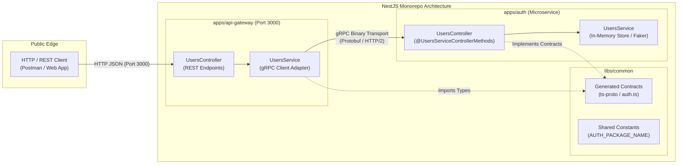
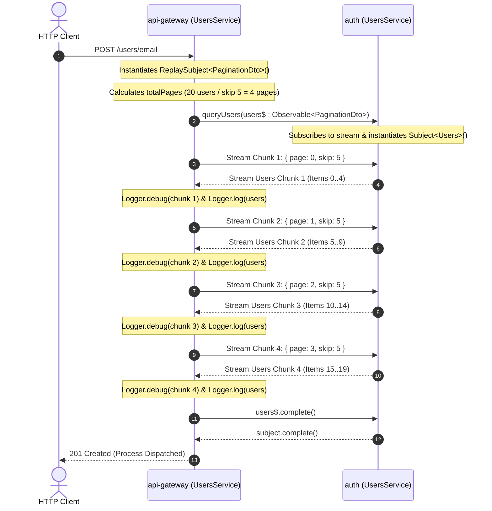

# poc-nestjs-grpc-monorepo

> A high-performance NestJS monorepo demonstrating an API Gateway REST proxy communicating with a headless Auth microservice over binary gRPC and reactive bidirectional streaming using RxJS and Protocol Buffers.

**Inception (First Commit):** `2025-02-17` • **Batch / Horizon:** `Batch 2024–2025` • **Architecture Domain:** `Microservices Monorepo / Binary RPC Transport`

---

## 📌 Architecture & Overview

`nestjs-gRPC` is structured as an enterprise-grade NestJS monorepo orchestrating distributed communication between an edge HTTP API Gateway and an internal microservice via high-efficiency **gRPC** transport. By decoupling public client consumption from internal inter-service communication, the system leverages Protocol Buffers (`proto3`) for strict contract enforcement, compact binary serialization, and reactive bidirectional streaming.



* **Context:** Architectural proof-of-concept and technical reference demonstrating microservice orchestration in NestJS using gRPC. It illustrates contract-first development using `ts-proto`, typed RPC client injection via `ClientsModule`, and reactive streams using RxJS `Observable` and `ReplaySubject`.
* **Key Patterns:**
  * **API Gateway Pattern:** The `api-gateway` acts as a public-facing reverse proxy, translating incoming REST/JSON requests into binary gRPC RPC invocations against internal microservices.
  * **Contract-First Code Generation:** Domain models and RPC interfaces are authored in `proto/auth.proto` and compiled into type-safe NestJS controllers, client interfaces, and decorators using `ts-proto` (`nestJs=true`).
  * **Bidirectional gRPC Streaming:** In addition to standard unary RPC calls, the architecture showcases bidirectional streaming where client pagination requests (`PaginationDto`) stream sequentially over HTTP/2, and the server yields chunked user batches (`Users`) reactively.
  * **Shared Monorepo Library:** Cross-cutting types, package constants, and generated DTOs reside in `libs/common`, ensuring end-to-end type safety and compile-time contract verification across all apps.

---

## 🔄 Bidirectional gRPC Streaming Workflow

The repository features an advanced bidirectional streaming implementation triggered by `POST /users/email`. Rather than executing a naive blocking database fetch or a single bulk request, the client pushes paginated cursors over a stream, while the server continuously dispatches user batches.



---

## 🛠 Tech Stack

* **Runtime & Framework:** Node.js (`>= 18`), TypeScript (`5.7.3`), NestJS (`11.0.10`)
* **Transport & Protocol Buffers:** `@grpc/grpc-js` (`1.12.6`), `@grpc/proto-loader` (`0.7.13`), `ts-proto` (`2.6.1`), Protocol Buffers `proto3`
* **Reactive Extensions:** `rxjs` (`7.8.1`) for streaming and asynchronous event propagation
* **Data Mocking & Utilities:** `@faker-js/faker` (`9.5.0`) for initial mock user generation
* **Build System & Tooling:** Nest CLI (`11.0.3`), SWC (`@swc/cli`, `@swc/core`), Webpack compiler assets, ESLint 9, Prettier 3
* **Package Management:** `pnpm`

---

## ✨ Features & Endpoints

### Key Architectural Capabilities

* **Strict Protocol Buffer Contracts:** Typed message schemas (`User`, `CreateUserDto`, `UpdateUserDto`, `FindOneUserDto`, `PaginationDto`, `SocialMedia`).
* **Clean Controller-Client Abstraction:** Automatic method registration via `UsersServiceControllerMethods` decorator generated by `ts-proto`.
* **Zero External Infrastructure Dependency:** Immediate local execution out-of-the-box with pre-seeded mock users on service bootstrap.
* **Pre-Configured Postman Collection:** Ready-to-import collection (`Nestjs-gRPC.postman_collection.json`) covering all REST proxy routes.

### REST API Endpoints (`api-gateway`)

| Method | Endpoint | Description | Downstream gRPC Target |
|---|---|---|---|
| `POST` | `/users` | Creates a new user entity | `auth.UsersService/CreateUser` |
| `GET` | `/users` | Retrieves all registered users | `auth.UsersService/FindAllUsers` |
| `GET` | `/users/:id` | Retrieves a specific user by UUID | `auth.UsersService/FindOneUser` |
| `PATCH` | `/users/:id` | Updates user details (e.g., social media URLs) | `auth.UsersService/UpdateUser` |
| `DELETE` | `/users/:id` | Deletes a user entity by UUID | `auth.UsersService/RemoveUser` |
| `POST` | `/users/email` | Triggers reactive bidirectional streaming pagination query | `auth.UsersService/QueryUsers` |

### Internal gRPC Service Interface (`auth`)

```protobuf
package auth;

service UsersService {
  rpc CreateUser(CreateUserDto) returns (User) {}
  rpc FindAllUsers(Empty) returns (Users) {}
  rpc FindOneUser(FindOneUserDto) returns (User) {}
  rpc UpdateUser(UpdateUserDto) returns (User) {}
  rpc RemoveUser(FindOneUserDto) returns (User) {}
  rpc QueryUsers(stream PaginationDto) returns (stream Users) {}
}
```

---

## 🚀 Getting Started

### Prerequisites

* **Node.js:** `>= 18.0.0` (LTS recommended)
* **Package Manager:** `pnpm` (or `npm` / `yarn`)
* **Protobuf Compiler (Optional):** `protoc` installed locally if modifying `proto/auth.proto`

### Installation

```bash
# Clone repository
git clone https://github.com/fabogit/poc-nestjs-grpc-monorepo.git
cd poc-nestjs-grpc-monorepo

# Install dependencies
pnpm install
```

### Compiling Protobuf Contracts (Optional)

TypeScript interfaces are pre-generated in `libs/common/src/types/auth.ts`. If you modify `proto/auth.proto`, recompile via:

```bash
protoc --plugin=./node_modules/.bin/protoc-gen-ts_proto \
  --ts_proto_out=./ \
  --ts_proto_opt=nestJs=true \
  ./proto/auth.proto
```

### Running the Services

The application requires running both the **Auth** microservice and the **API Gateway** concurrently. Open two terminal instances:

```bash
# Terminal 1: Start Auth gRPC Microservice
pnpm run start:dev auth

# Terminal 2: Start API Gateway REST Proxy
pnpm run start:dev api-gateway
```

Once running:
* **API Gateway (REST):** Accessible on `http://localhost:3000`
* **Auth Microservice (gRPC):** Listening on internal transport (`localhost:50051`)

### Testing via Postman / cURL

Import `Nestjs-gRPC.postman_collection.json` into Postman, or execute sample cURL commands:

```bash
# 1. Fetch all users
curl -X GET http://localhost:3000/users

# 2. Create a new user
curl -X POST http://localhost:3000/users \
  -H "Content-Type: application/json" \
  -d '{
    "username": "alex_dev",
    "password": "SecurePassword123!",
    "age": 28
  }'

# 3. Trigger Bidirectional Streaming Query
curl -X POST http://localhost:3000/users/email
```

Check the `api-gateway` console log to observe chunked streaming reception:
```text
[UsersService] Skipping: 5 on 20 users, chunk number: 1
[UsersService] { users: [ ... ] }
[UsersService] Skipping: 5 on 20 users, chunk number: 2
...
```

---

## 🧪 Testing & Quality Assurance

```bash
# Execute unit tests
pnpm run test

# Execute test coverage
pnpm run test:cov

# Run linter with autofix
pnpm run lint

# Format code
pnpm run format
```

> [!NOTE]
> The original boilerplate E2E tests (`apps/*/test/app.e2e-spec.ts`) target a default `GET /` route that was superseded by feature routes. Integration verification against gRPC services requires dedicated mocked gRPC clients or live microservices.

---

## 📄 License & Author

Developed by [@fabogit](https://github.com/fabogit).
Licensed under [UNLICENSED](package.json).
